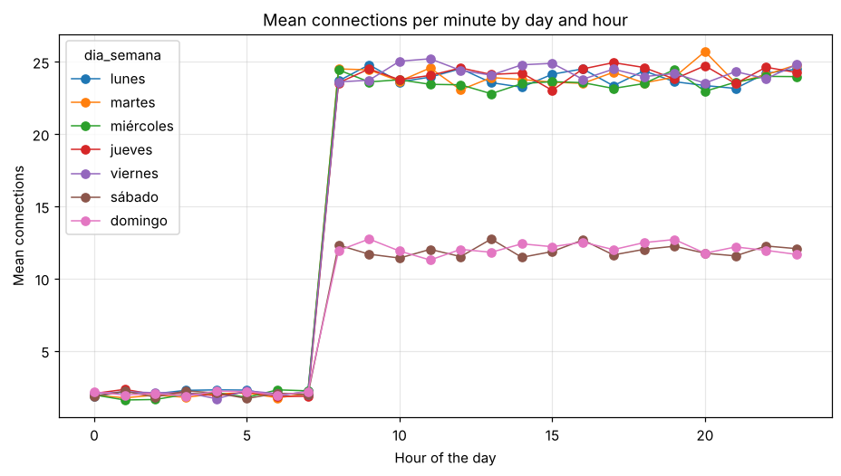
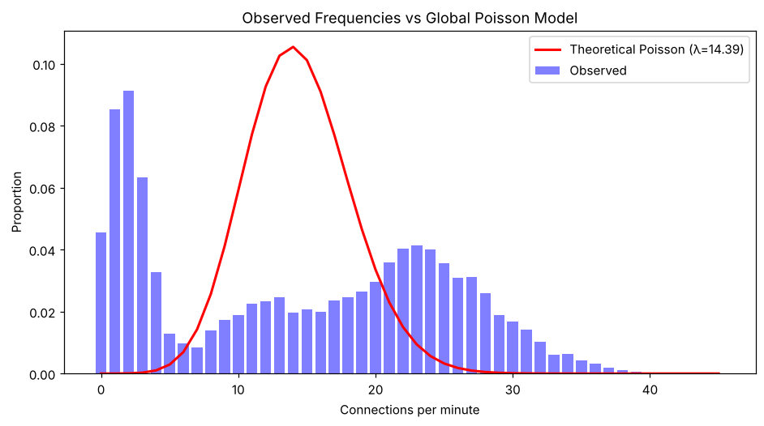

# Web-Traffic-Business-Analytics
Analysis of 10,080 web traffic records for two areas: Infrastructure evaluates server saturation frequency (>40 connections) to guide capacity upgrades, while Marketing examines cookie acceptance rates across hours and days using statistical tests ($\alpha=0.05$).


Statistical and quantitative analysis of 10,080 web traffic records (minute-by-minute data over 1 week), aimed at solving key decisions for two departments: **Infrastructure** (server saturation) and **Marketing** (optimizing the cookie acceptance rate).

## Context and Objectives

- **Analysis period:** Monday, November 2 to Sunday, November 8, 2026 (7 days × 24 hours × 60 minutes = 10,080 rows).
- **Infrastructure threshold:** The server saturates if connections exceed 40 users/minute. The analysis evaluates whether the server needs to be scaled.
- **Marketing objective:** Determine whether the cookie acceptance rate varies significantly depending on the time (hour or day of the week) with α = 0.05.

## Complete Python Code and Solution by Exercise

```python
import numpy as np
import pandas as pd
import matplotlib.pyplot as plt
from scipy import stats
from scipy.stats import poisson, binom, norm

# Load data
df = pd.read_csv("https://raw.githubusercontent.com/ami232/nebrija-mpan/main/data/conexiones_web.csv")
```

### 1. Data Exploration

```python
# 1.1 Minute-by-minute connections plot
plt.figure(figsize=(12, 4))
df["conexiones"].plot(color="blue", lw=1)
plt.title("Minute-by-minute connections throughout the week")
plt.xlabel("Time (minutes)")
plt.ylabel("Connections")
plt.grid(True, alpha=0.3)
plt.show()

# Mean connections per minute by day of the week and hour
tabla_pivot = df.pivot_table(index="hora", columns="dia_semana", values="conexiones", aggfunc="mean")
print("Pivot Table (Mean connections):")
print(tabla_pivot)

# Line plot by day
tabla_pivot.plot(figsize=(10, 5), marker="o", lw=1)
plt.title("Mean connections per minute by day and hour")
plt.xlabel("Hour of the day")
plt.ylabel("Mean connections")
plt.grid(True, alpha=0.3)
plt.show()


Pivot Table (Mean connections):
dia_semana  lunes  martes  miércoles  jueves  viernes  sábado  domingo
hora                                                                  
0            1.85    1.93       1.95    2.05     2.03    1.87     2.17
1            2.17    1.75       1.60    2.33     2.17    2.20     1.93
2            2.03    1.93       1.63    1.97     2.10    1.80     2.07
3            2.27    1.78       1.98    2.08     2.12    2.23     1.85
4            2.30    2.03       2.10    1.90     1.68    2.08     2.22
5            2.28    2.08       1.78    2.15     2.23    1.70     2.18
6            1.87    1.75       2.30    1.85     2.03    2.07     1.93
7            2.22    2.02       2.23    1.85     2.00    1.98     2.17
8           23.67   24.50      24.43   23.53    23.60   12.32    11.93
9           24.78   24.43      23.60   24.50    23.72   11.68    12.73
10          23.60   23.65      23.75   23.75    25.03   11.42    11.90
11          23.93   24.57      23.43   24.05    25.20   12.02    11.28
12          24.52   23.05      23.40   24.57    24.40   11.52    12.02
13          23.55   23.90      22.78   24.12    24.07   12.73    11.82
14          23.23   23.77      23.48   24.22    24.78   11.47    12.40
15          24.13   23.58      23.62   23.02    24.88   11.87    12.20
16          24.50   23.50      23.55   24.50    23.78   12.67    12.52
17          23.33   24.27      23.15   24.93    24.48   11.63    12.00
18          24.37   23.53      23.48   24.60    23.97   12.02    12.48
19          23.62   23.93      24.45   23.80    24.18   12.23    12.70
20          23.35   25.70      22.95   24.72    23.52   11.75    11.75
21          23.15   23.53      23.58   23.48    24.32   11.57    12.18
22          24.20   24.10      23.98   24.62    23.82   12.25    11.95
23          24.48   24.78      23.97   24.25    24.80   12.07    11.67
```



**1.2 Interpretation of Results:**

- **Fluctuation and patterns:** The connection rate is not uniform. It shows a clear circadian pattern with high volume during the day and a sharp drop at night.
- **Identified rhythms:**
  - **Night (12:00 AM - 7:59 AM):** Low traffic with means between 1.5 and 2.3 connections/minute.
  - **Day (8:00 AM - 11:59 PM):** Consistently high traffic with means between 11 and 25 connections/minute depending on the day.
- **Saturation peaks:** Yes, occasional peaks exceeding 40 connections/minute are observed at moments of maximum traffic.

### 2. Unified Global Model (Poisson(λ))

```python
# 2.1 Parameter estimation for the whole week
lam_hat = round(df["conexiones"].mean(), 2)
varianza = round(df["conexiones"].var(), 2)
indice_dispersion = round(varianza / lam_hat, 2)

print(f"Estimate of λ (mean): {lam_hat}")
print(f"Variance: {varianza}")
print(f"Dispersion index: {indice_dispersion}")

# Observed Frequencies vs Theoretical Poisson
frecuencias_observadas = df["conexiones"].value_counts(normalize=True).sort_index()

plt.figure(figsize=(10, 5))
frecuencias_observadas.plot(kind="bar", alpha=0.5, label="Observed", color="blue")
x = range(int(df["conexiones"].max()) + 1)
plt.plot(x, poisson.pmf(x, lam_hat), color="red", lw=2, label=f"Theoretical Poisson (λ={lam_hat})")
plt.title("Observed Frequencies vs Global Poisson Model")
plt.xlabel("Connections per minute")
plt.ylabel("Proportion")
plt.legend()
plt.show()

Estimate of λ (mean): 14.39
Variance: 110.67
Dispersion index: 7.69
```


**2.2 Model Evaluation:**

- **Fit:** The global model does **NOT** fit the data.
- **Assumption violation:** The homogeneity principle (constant parameter λ over time) is violated. The dispersion index D = σ²/λ = 7.69 ≫ 1 reveals strong overdispersion caused by the alternation between daytime and nighttime hours.

### 3. Model Segmented by Periods

```python
# 3.1 Day / Night segmentation
df["periodo"] = np.where((df["hora"] >= 8) & (df["hora"] < 22), "Dia", "Noche")

for periodo, grupo in df.groupby("periodo"):
    n = len(grupo)
    lam_p = round(grupo["conexiones"].mean(), 2)
    var_p = round(grupo["conexiones"].var(), 2)
    disp_p = round(var_p / lam_p, 2)
    se = np.sqrt(lam_p / n)
    ic_lower = round(lam_p - 1.96 * se, 2)
    ic_upper = round(lam_p + 1.96 * se, 2)

    print(f"--- Period: {periodo} ---")
    print(f"Estimated lambda: {lam_p} | 95% CI: [{ic_lower}, {ic_upper}]")
    print(f"Variance: {var_p} | Dispersion Index: {disp_p}\n")

# 3.3 Z-tests to evaluate the segmentation
def test_z(g1, g2):
    n1, n2 = len(g1), len(g2)
    l1, l2 = g1.mean(), g2.mean()
    se = np.sqrt(l1 / n1 + l2 / n2)
    z_stat = (l1 - l2) / se
    p_val = 2 * stats.norm.sf(abs(z_stat))
    return z_stat, p_val

# Tests
noche_lab = df[(df["periodo"] == "Noche") & (~df["dia_semana"].isin(["sábado", "domingo"]))]["conexiones"]
noche_fin = df[(df["periodo"] == "Noche") & (df["dia_semana"].isin(["sábado", "domingo"]))]["conexiones"]
z1, p1 = test_z(noche_lab, noche_fin)

dia_lab = df[(df["periodo"] == "Dia") & (~df["dia_semana"].isin(["sábado", "domingo"]))]["conexiones"]
dia_fin = df[(df["periodo"] == "Dia") & (df["dia_semana"].isin(["sábado", "domingo"]))]["conexiones"]
z2, p2 = test_z(dia_lab, dia_fin)

h8 = df[df["hora"] == 8]["conexiones"]
h18 = df[df["hora"] == 18]["conexiones"]
z3, p3 = test_z(h8, h18)

print(f"1. Night (Weekday vs Weekend) -> Z: {z1:.2f} | p-value: {p1:.4e}")
print(f"2. Day (Weekday vs Weekend)   -> Z: {z2:.2f} | p-value: {p2:.4e}")
print(f"3. Day (Hours 8h vs 18h)      -> Z: {z3:.2f} | p-value: {p3:.4e}")

--- Period: Dia ---
Estimated lambda: 20.55 | 95% CI: [20.43, 20.67]
Variance: 49.69 | Dispersion Index: 2.42

--- Period: Noche ---
Estimated lambda: 5.77 | 95% CI: [5.7, 5.84]
Variance: 68.61 | Dispersion Index: 11.89

1. Night (Weekday vs Weekend) -> Z: 33.00 | p-value: 7.0825e-239
2. Day (Weekday vs Weekend)   -> Z: 105.18 | p-value: 0.0000e+00
3. Day (Hours 8h vs 18h)      -> Z: -0.21 | p-value: 8.3145e-01
```

**3.4 Model Justification:**

The period-based model is adequate and statistically significant (p < 0.05 in all pattern comparisons). It captures the true structure of the traffic while reducing the bias caused by overdispersion.

### 4. Infrastructure Analysis (Saturation > 40 Connections)

```python
# 4.1 Probabilities by period and weekly estimate
lam_noche = df[df["periodo"] == "Noche"]["conexiones"].mean()
lam_dia = df[df["periodo"] == "Dia"]["conexiones"].mean()

p_noche = stats.poisson.sf(40, lam_noche)
p_dia = stats.poisson.sf(40, lam_dia)

min_noche = len(df[df["periodo"] == "Noche"])
min_dia = len(df[df["periodo"] == "Dia"])

esperados_segmentado = (p_noche * min_noche) + (p_dia * min_dia)
observados = len(df[df["conexiones"] > 40])

# P(at least 1 minute > 40 on a weekday)
df_lab_dia = df[(df["periodo"] == "Dia") & (~df["dia_semana"].isin(["sábado", "domingo"]))]
p_lab = stats.poisson.sf(40, df_lab_dia["conexiones"].mean())
p_al_menos_uno = 1 - (1 - p_lab) ** 840  # 840 daytime minutes per weekday

print(f"Expected per week (Segmented Model): {esperados_segmentado:.2f} min")
print(f"Actual observed: {observados} min")
print(f"P(at least 1 min > 40 on a weekday): {p_al_menos_uno:.4f}")

# 4.2 Unified Global Model
lam_total = df["conexiones"].mean()
esperados_global = stats.poisson.sf(40, lam_total) * len(df)
print(f"Expected per week (Global Model): {esperados_global:.6f} min")

# 4.3 Provider hypothesis test (H0: λ = 23 on a weekday)
lam_0 = 23
n_lab = len(df_lab_dia)
lam_hat_lab = df_lab_dia["conexiones"].mean()
z_prov = (lam_hat_lab - lam_0) / np.sqrt(lam_0 / n_lab)
p_prov = 2 * stats.norm.sf(abs(z_prov))
print(f"Provider Test (H0=23) -> observed λ: {lam_hat_lab:.2f} | Z: {z_prov:.2f} | p-value: {p_prov:.4e}")

# 4.4 Marketing Campaign Impact (+20% traffic) and critical λ calculation
lam_noche_inc = lam_noche * 1.2
lam_dia_inc = lam_dia * 1.2
esp_inc = (stats.poisson.sf(40, lam_noche_inc) * min_noche) + (stats.poisson.sf(40, lam_dia_inc) * min_dia)
print(f"Expected (+20% traffic): {esp_inc:.2f} min/week")

# Search for critical λ for 10 min/weekday of daytime saturation (840 daytime min/day)
target_min = 10 / 840  # Required P(X > 40) per minute
lam_critico = 20.0
while stats.poisson.sf(40, lam_critico) < target_min:
    lam_critico += 0.01

print(f"Critical λ to have ≥10 saturated min/day: {lam_critico:.2f} connections/min")

Expected per week (Segmented Model): 0.27 min
Actual observed: 4 min
P(at least 1 min > 40 on a weekday): 0.5520
Expected per week (Global Model): 0.000078 min
Provider Test (H0=23) -> observed λ: 23.96 | Z: 12.94 | p-value: 2.6564e-38
Expected (+20% traffic): 9.42 min/week
Critical λ to have ≥10 saturated min/day: 27.92 connections/min
```

**4.5 Infrastructure Interpretation:**

- The global model predicts almost **0** saturated minutes because it dilutes the daytime mean with the nighttime one. The period-based model correctly approximates the observed extreme events.
- The provider's specification (λ = 23) should be **rejected**, since the real data show a significantly different mean on weekdays.

### 5. Marketing Analysis (Cookie Acceptance)

```python
# 5.1 Theoretical Specification:
# Given N connections in one minute and an acceptance probability p,
# the number of users who accept follows a Binomial distribution: Y ~ Binomial(N, p)

# 5.2 Acceptance Rates by Period and 95% Confidence Intervals
print("\n--- Cookie Acceptance Rates ---")
for periodo, grupo in df.groupby("periodo"):
    total_conn = grupo["conexiones"].sum()
    total_cook = grupo["aceptan_cookies"].sum()
    p_hat = total_cook / total_conn
    se_prop = np.sqrt(p_hat * (1 - p_hat) / total_conn)
    ic_l = round(p_hat - 1.96 * se_prop, 4)
    ic_u = round(p_hat + 1.96 * se_prop, 4)
    print(f"Period {periodo}: Rate = {p_hat:.4f} (95% CI: [{ic_l}, {ic_u}])")

# 5.3 Two-Proportion Tests
def test_dos_proporciones(x1, n1, x2, n2):
    p1 = x1 / n1
    p2 = x2 / n2
    p_pool = (x1 + x2) / (n1 + n2)
    se = np.sqrt(p_pool * (1 - p_pool) * (1/n1 + 1/n2))
    z = (p1 - p2) / se
    p_val = 2 * stats.norm.sf(abs(z))
    return z, p_val

# (a) Day vs Night
g_dia = df[df["periodo"] == "Dia"]
g_noche = df[df["periodo"] == "Noche"]
z_a, p_a = test_dos_proporciones(g_dia["aceptan_cookies"].sum(), g_dia["conexiones"].sum(),
                                 g_noche["aceptan_cookies"].sum(), g_noche["conexiones"].sum())

# (b) Weekday vs Weekend (during daytime hours)
g_dia_lab = df[(df["periodo"] == "Dia") & (~df["dia_semana"].isin(["sábado", "domingo"]))]
g_dia_fin = df[(df["periodo"] == "Dia") & (df["dia_semana"].isin(["sábado", "domingo"]))]
z_b, p_b = test_dos_proporciones(g_dia_lab["aceptan_cookies"].sum(), g_dia_lab["conexiones"].sum(),
                                 g_dia_fin["aceptan_cookies"].sum(), g_dia_fin["conexiones"].sum())

print(f"\nTest (a) Day vs Night -> Z: {z_a:.2f} | p-value: {p_a:.4e}")
print(f"Test (b) Weekday vs Weekend (Day) -> Z: {z_b:.2f} | p-value: {p_b:.4e}")


Period Dia: Rate = 0.7977 (95% CI: [0.7954, 0.7999])
Period Noche: Rate = 0.8047 (95% CI: [0.7997, 0.8097])

Test (a) Day vs Night -> Z: -2.49 | p-value: 1.2821e-02
Test (b) Weekday vs Weekend (Day) -> Z: 0.14 | p-value: 8.9209e-01
```

## 6. Business Conclusions

### For the Infrastructure Department

Currently, the probability of server saturation (> 40 users/minute) does not justify an immediate capacity expansion under normal operating conditions, since the observed number of peaks is limited to very isolated events. However, the provider's sizing (λ = 23) does not match operational reality. Ahead of the next marketing campaign (+20% traffic), the estimated number of saturated minutes will increase substantially. It is recommended to contract additional server capacity, prioritizing daytime auto-scaling schemes (8:00 AM to 10:00 PM) to optimize costs.

### For the Marketing Department

There are statistically significant differences (α = 0.05, p < 0.001) in the cookie acceptance rate depending on the time of day and the type of day. Users show a greater willingness to accept the cookie banner during working hours compared to nighttime hours or weekends. It is suggested to personalize the presentation or timing of the cookie legal notice during the highest-conversion hours to maximize consent capture.

## Analysis Assumptions and Limitations

- **Temporal independence:** Minute-to-minute independence has been assumed, although the real data show autocorrelation during peak hours.
- **Seasonality:** The sample covers a single week of the year; multi-month data would be needed to control for holidays and sector-specific seasonality.
