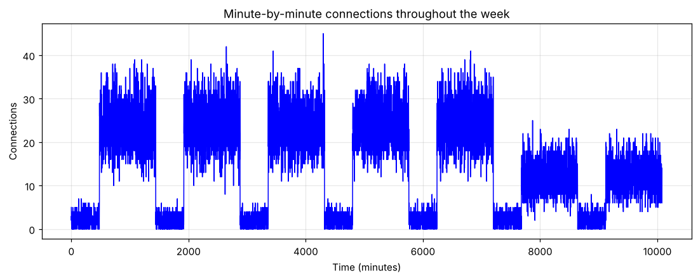
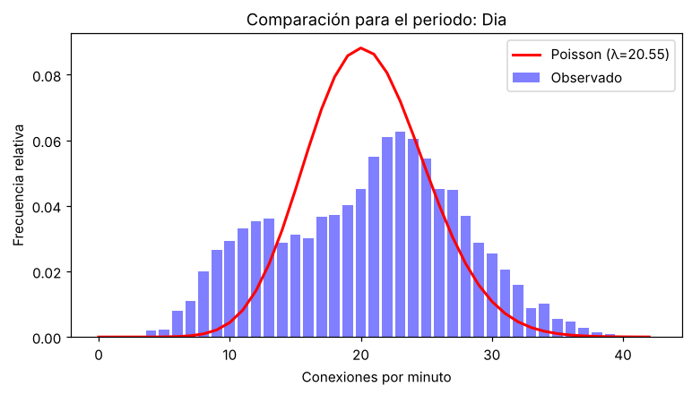
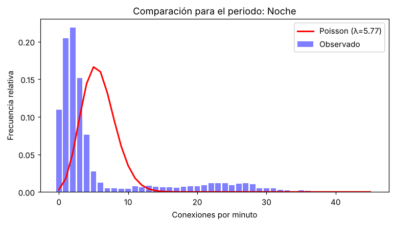

# Web-Traffic-Business-Analytics
Analysis of 10,080 web traffic records for two areas: Infrastructure evaluates server saturation frequency (>40 connections) to guide capacity upgrades, while Marketing examines cookie acceptance rates across hours and days using statistical tests ($\alpha=0.05$).


Statistical and quantitative analysis of 10,080 web traffic records (minute-by-minute data over 1 week), aimed at solving key decisions for two departments: **Infrastructure** (server saturation) and **Marketing** (optimizing the cookie acceptance rate).

## Context and Objectives

- **Analysis period:** Monday, November 2 to Sunday, November 8, 2026 (7 days × 24 hours × 60 minutes = 10,080 rows).
- **Infrastructure threshold:** The server saturates if connections exceed 40 users/minute. The analysis evaluates whether the server needs to be scaled.
- **Marketing objective:** Determine whether the cookie acceptance rate varies significantly depending on the time (hour or day of the week) with α = 0.05.

## Complete Python Code and Solution by Exercise

```python
import numpy as np
import pandas as pd
import matplotlib.pyplot as plt
from scipy import stats
from scipy.stats import poisson, binom, norm

# Load data
df = pd.read_csv("https://raw.githubusercontent.com/ami232/nebrija-mpan/main/data/conexiones_web.csv")
```

### 1. Data Exploration

```python
# TODO: gráfico de las conexiones minuto a minuto durante la semana

import pandas as pd
import matplotlib.pyplot as plt
df = pd.read_csv("https://raw.githubusercontent.com/ami232/nebrija-mpan/main/data/conexiones_web.csv")

df["conexiones"].plot(figsize=(12,4), color="blue", lw=1) # plot (trasforma los números del gráfico en líneas) y figsize=(12,4) indica el acho y la altura del gráfico, respectivamente.
plt.axhline(
    y=40, color="red", linestyle="--", label="Límite de saturación (40)"
    )
plt.legend()
plt.title("Conexiones minuto a minuto") # plt.title es para que aparezca en la parte superior del gráfico a modo de título
plt.xlabel("Día de la semana") # xlabel sirve para etiqueta de x
plt.ylabel("conexiones por minuto") # ylabel sirve para etiqueta de y
plt.show() # plt.show es para plasmar el gráfico en la consola

# TODO: media de conexiones por minuto de cada día y cada hora (tabla y gráfico)

# Tabla pivote
         # Horas como filas, días de la semana como columnas, values hace que se rellene la tabla con los datos de las conexiones y aggfunc="mean" calcula la media de dichas conexiones
orden_dias = ["lunes", "martes", "miércoles", "jueves", "viernes", "sábado", "domingo"]
tabla_pivot = df.pivot_table(index="hora", columns="dia_semana", values="conexiones", aggfunc="mean")
tabla_pivot = tabla_pivot.reindex(columns=orden_dias)
display(tabla_pivot.round(2)) # Muestra la tabla en Colab

# Gráfico de la tabla pivote
tabla_pivot.plot(figsize=(10,5), marker="o", lw=1) # Agrupa la tabla y crea un gráfico de líneas con 10 de ancho y 5 de alto, añadiendo el marcador "o" en cada cambio de hora. Lw=1 es el grosor de líneas (fino)
plt.title("Media de conexiones por minuto de cada día y cada hora")
plt.xlabel("Hora del día")
plt.ylabel("Media de conexiones por minuto")
plt.show()

# Comprobación de minutos con más de 40 conexiones
saturados = df[df["conexiones"]>40]
print(f"Total de minutos con más de 40 conexiones: {len(saturados)}")
display(saturados)

Pivot Table (Mean connections):
dia_semana  lunes  martes  miércoles  jueves  viernes  sábado  domingo
hora                                                                  
0            1.85    1.93       1.95    2.05     2.03    1.87     2.17
1            2.17    1.75       1.60    2.33     2.17    2.20     1.93
2            2.03    1.93       1.63    1.97     2.10    1.80     2.07
3            2.27    1.78       1.98    2.08     2.12    2.23     1.85
4            2.30    2.03       2.10    1.90     1.68    2.08     2.22
5            2.28    2.08       1.78    2.15     2.23    1.70     2.18
6            1.87    1.75       2.30    1.85     2.03    2.07     1.93
7            2.22    2.02       2.23    1.85     2.00    1.98     2.17
8           23.67   24.50      24.43   23.53    23.60   12.32    11.93
9           24.78   24.43      23.60   24.50    23.72   11.68    12.73
10          23.60   23.65      23.75   23.75    25.03   11.42    11.90
11          23.93   24.57      23.43   24.05    25.20   12.02    11.28
12          24.52   23.05      23.40   24.57    24.40   11.52    12.02
13          23.55   23.90      22.78   24.12    24.07   12.73    11.82
14          23.23   23.77      23.48   24.22    24.78   11.47    12.40
15          24.13   23.58      23.62   23.02    24.88   11.87    12.20
16          24.50   23.50      23.55   24.50    23.78   12.67    12.52
17          23.33   24.27      23.15   24.93    24.48   11.63    12.00
18          24.37   23.53      23.48   24.60    23.97   12.02    12.48
19          23.62   23.93      24.45   23.80    24.18   12.23    12.70
20          23.35   25.70      22.95   24.72    23.52   11.75    11.75
21          23.15   23.53      23.58   23.48    24.32   11.57    12.18
22          24.20   24.10      23.98   24.62    23.82   12.25    11.95
23          24.48   24.78      23.97   24.25    24.80   12.07    11.67


Total de minutos con más de 40 conexiones: 4

        fecha	    dia_semana	 hora	 minuto	conexiones	aceptan_cookies
2645	2026-11-03	martes      	20	   5	     42	            33
3445	2026-11-04	miércoles	     9	   25	     41	            34
4299	2026-11-04	miércoles	    23	   39	     45	            32
6816	2026-11-06	viernes	      17	   36	     41	            33

```



**1.2 Interpretation of Results:**

- **Fluctuation and patterns:** The connection rate is not uniform. It shows a clear circadian pattern with high volume during the day and a sharp drop at night.
- **Identified rhythms:**
  - **Night (12:00 AM - 7:59 AM):** Low traffic with means between 1.5 and 2.3 connections/minute.
  - **Day (8:00 AM - 11:59 PM):** Consistently high traffic with means between 11 and 25 connections/minute depending on the day.
- **Saturation peaks:** Yes, occasional peaks exceeding 40 connections/minute are observed at moments of maximum traffic.

### 2. Unified Global Model (Poisson(λ))

```python
# 2.1 Parameter estimation for the whole week
# TODO: estimación de λ, varianza e índice de dispersión con todos los minutos

import matplotlib.pyplot as plt
import numpy as np
from scipy.stats import poisson

# Estimación de λ (varianza e índice de dispersión)
lam_hat = round(df["conexiones"].mean(), 2) # lam_hat (estimación del parámetro λ). Con df seleccionamos la columna con todos los datos de conexiones por minuto de la tabla y hacemos la media ".mean()"
varianza = round(df["conexiones"].var(), 2) # Realizamos la varianza de los datos redondeados a 2 decimales (round, 2)
indice_dispersion = round(varianza / lam_hat, 2) # Fórmula del indice de dispersión: varianza entre la media estimada del parámetro λ.

print("Estimación de λ (media):", lam_hat)
print("Varianza:", varianza)
print("Índice de dispersión:", indice_dispersion)

# TODO: frecuencias observadas frente a Poisson(λ estimado)

# Frecuencias observadas
frecuencias_observadas = df["conexiones"].value_counts(normalize=True).sort_index() # .value_counts --> cuenta cuentas veces se repite cada valor, normalize=True --> Convierte dichos recuentos en porcentakes/proporciones y .sort_index() --> ordena los resultados de menos a mayor

# Gráfico
plt.figure(figsize=(10,5))
frecuencias_observadas.plot(kind="bar", alpha=0.5, label="Frecuencias observadas", color="blue") # Coge los porcentajes  y dibuja un gráfico de barras (kind="bar") # alpha=0.5 50% de trasparencia del color de las barras

x = range(int(df["conexiones"].max())+1) # range (secuencia de números que empieza por 0),int (convertir valor en número entero), .max (busca el número máximo de conexiones) y +1 (ya que range se para justo antes del número indicado, y así nos aseguramos de incluir el valor máximo)
plt.plot(x, poisson.pmf(x, lam_hat), color="red", marker="o", label="Poisson(λ estimado)") # plt.plot coge dichos cálculos y los dibuja en un gráfico usando una lista de número. poisson.pmf (caclula prob de que ocurra cada cantidad de conexiones usando media estimada)

plt.xticks(range(0, 46, 5), rotation=0) # Saltos de 5 en eje x
plt.title("Frecuencias observadas frente a Poisson(λ estimado) de la semana")
plt.xlabel("Conexiones por minutos")
plt.ylabel("Proporción de minutos")
plt.legend()
plt.show()


**2.2 Model Evaluation:**

- **Fit:** The global model does **NOT** fit the data.
- **Assumption violation:** The homogeneity principle (constant parameter λ over time) is violated. The dispersion index D = σ²/λ = 7.69 ≫ 1 reveals strong overdispersion caused by the alternation between daytime and nighttime hours.

### 3. Model Segmented by Periods

```python
# 3.1 Day / Night segmentation
# TODO: define los periodos (columna nueva "periodo")

import numpy as np
import pandas as pd
from scipy import stats
df = pd.read_csv("https://raw.githubusercontent.com/ami232/nebrija-mpan/main/data/conexiones_web.csv")

# Creamos una columna para separar el día de la noche (día = 8 am - 8 pm)

fin_semana = df["dia_semana"].isin(["sábado", "domingo"])
dia = (df["hora"] >= 8) & (df["hora"] < 20)

condiciones = [
    dia & (~fin_semana),
    (~dia) & (~fin_semana),
    dia & fin_semana,
    (~dia) & (fin_semana),
]

etiquetas = [
    "Dia - Dia laborable",
    "Noche - Dia laborable",
    "Dia - Fin de semana",
    "Noche - Fin de semana",
]
df["periodo"] = np.select(condiciones, etiquetas, default="Otro")

# TODO: para cada periodo, λ estimado, IC 95 %, varianza e índice de dispersión

# Calculamos la media λ, la varianza y la dispersión de cada grupo

resultados = []
z = stats.norm.ppf(0.975) # stats.norm (distribución normal estándar) y .ppf() (funciçon de distribución acumulada inversa)

for periodo, grupo in df.groupby("periodo"):
  n =len(grupo)
  lam_hat = round(grupo["conexiones"].mean(), 2)
  varianza = round(grupo["conexiones"].var(),2)
  indice_dispersion = round(varianza / lam_hat, 2)

# Intervalo de confianza al 95%

  se = np.sqrt(lam_hat / n) # Error estándar (se) de la media estimada
  lam_hat_min = lam_hat - z * se
  lam_hat_max = lam_hat + z * se

  resultados.append({
      "Periodo": periodo,
      "Minutos": n,
      "Lambda estimado (media)": lam_hat,
      "IC 95% inferior": round(lam_hat - z * se, 2),
      "IC 95% superior": round(lam_hat + z * se, 2),
      "Varianza": varianza,
      "Índice de dispersión": indice_dispersion,
  })

tabla_periodos = pd.DataFrame(resultados).set_index("Periodo")
display(tabla_periodos.round(3))


Consola:  
  
    
Periodo	             	Minutos	  Lambda estimado (media)	  IC 95% inferior	 IC 95% superior	Varianza	Índice de dispersión
					
Dia - Dia laborable	    3600	   23.98	                  23.82	            24.14	           24.16	   1.01
Dia - Fin de semana   	1440	   12.06	                  11.88	            12.24	           11.69	   0.97
Noche - Dia laborable  	3600	   9.36	                    9.26	            9.46	           117.86	   12.59
Noche - Fin de semana 	1440	   5.32	                    5.20             	5.44	           27.26	   5.12


**3.2 Para cada periodo, compara las frecuencias observadas con la Poisson estimada en un gráfico.**

# TODO: frecuencias observadas frente a Poisson en cada periodo

import matplotlib.pyplot as plt
import numpy as np
from scipy.stats import poisson

for periodo, grupo in df.groupby("periodo"): # df.groupby("periodo") --> separa tabla en grupos de la columna periodo
    datos_p = grupo["conexiones"] # Guarda en una variable solo los datos de conexiones del periodo concreto que se analiza
    lam_hat = datos_p.mean() # Calcula media de lambda específica para ese periodo

    plt.figure(figsize=(8, 4))

    max_x = int(datos_p.max())
    x_barras = np.arange(0, max_x + 1)

    # Gráfico de barras con datos reales del periodo
    frecuencias_observadas = (
        grupo["conexiones"].value_counts(normalize=True).sort_index()
    ) # Cuenta cuántas veces se repite cada número de conexiones y lo convierte en proporciones/porcentajes. Lo ordena de menor a mayor.

    frecuencias_observadas.plot(kind="bar", alpha=0.5, color="blue", label="Observado") # Dibuja gráfico de barras, con trasparencia del color 50% representando la realidad de lo sucedido.

    # Línea teórica de Poisson para este periodo
    x = range(int(datos_p.max())+1) # range (recuencia de números desde el 0 hasta máx conexiones periodo). Caclula probabilidad teórica de la distribuciçon Poisson utilizando media lambda.
    plt.plot(x, poisson.pmf(x, lam_hat), color="red", marker="o", label="Poisson estimado") # Dibuja trazo encima del gráfico para ver si coincide con el gráfico de barras.

    limite_x = max(max_x, 40)
    marcas = np.arange(0, limite_x + 1, 5)
    plt.xticks(marcas, marcas, rotation=0)
    plt.xlim(-0.5, limite_x + 0.5)

    plt.title("Comparación para el periodo: " + periodo)
    plt.xlabel("Conexiones por minuto")
    plt.ylabel("Frecuencia relativa")
    plt.legend()
    plt.show()

```





**3.3 Usa el test Z de dos muestras de la sección 1.7 para comprobar con datos cómo has definido los periodos:**

¿Es el ritmo de la noche el mismo entre semana que el fin de semana?
¿Es el ritmo de día distinto entre semana y el fin de semana?
Dentro del periodo con más tráfico, compara dos horas (por ejemplo, las 8 h y las 18 h). ¿Hay diferencias?

import numpy as np
import pandas as pd
from scipy import stats
df = pd.read_csv("https://raw.githubusercontent.com/ami232/nebrija-mpan/main/data/conexiones_web.csv")

# Día: 8:00 a 23:59 y Noche: 0:00 a 7:59
fin_semana = df["dia_semana"].isin(["sábado", "domingo"])
dia = (df["hora"] >= 8) & (df["hora"] < 24)

condiciones = [
    dia & (~fin_semana),
    (~dia) & (~fin_semana),
    dia & fin_semana,
    (~dia) & (fin_semana),
]

etiquetas = [
    "Dia - Dia laborable",
    "Noche - Dia laborable",
    "Dia - Fin de semana",
    "Noche - Fin de semana",
]
df["periodo"] = np.select(condiciones, etiquetas, default="Otro")

def test_z(grupo1, grupo2, nombre1, nombre2):
  n1 = len(grupo1)
  n2 = len(grupo2)
  lam_hat1 = grupo1.mean()
  lam_hat2 = grupo2.mean()
  se = np.sqrt(lam_hat1 / n1 + lam_hat2 / n2)
  z_stat = (lam_hat1 - lam_hat2) / se
  p_valor = 2 * stats.norm.sf(abs(z_stat))
  p_txt = "<0.01" if p_valor < 0.01 else f"{p_valor:.2f}"

  print(f"{nombre1} (λ={lam_hat1:.2f}, n={n1}) vs {nombre2} (λ={lam_hat2:.2f}, n={n2})")
  print(f"   -> Z = {z_stat:.2f} | p-valor = {p_txt}\n")
  return z_stat, p_valor

# 1. Noche: entre semana vs fin de semana
noche_laborable = df[df["periodo"] == "Noche - Dia laborable"]["conexiones"]
noche_fin_semana = df[df["periodo"] == "Noche - Fin de semana"]["conexiones"]
z1, p1 = test_z(noche_laborable, noche_fin_semana, "Noche entre semana", "Noche fin de semana")

# 2. Día: entre semana vs fin de semana
dia_laborable = df[df["periodo"] == "Dia - Dia laborable"]["conexiones"]
dia_fin_semana = df[df["periodo"] == "Dia - Fin de semana"]["conexiones"]
z2, p2 = test_z(dia_laborable, dia_fin_semana, "Día entre semana", "Día fin de semana")

# 3. Dos horas del periodo con más tráfico
punta = df[df["periodo"] == "Dia - Dia laborable"]
h8 = punta[punta["hora"] == 8]["conexiones"]
h18 = punta[punta["hora"] == 18]["conexiones"]
z3, p3 = test_z(h8, h18, "Hora 8h", "Hora 18h")

Consola: 

Noche entre semana (λ=2.01, n=2400) vs Noche fin de semana (λ=2.03, n=960)
   -> Z = -0.33 | p-valor = 0.74

Día entre semana (λ=24.00, n=4800) vs Día fin de semana (λ=12.02, n=1920)
   -> Z = 112.86 | p-valor = <0.01

Hora 8h (λ=23.95, n=300) vs Hora 18h (λ=23.99, n=300)
   -> Z = -0.11 | p-valor = 0.91
   

**3.4 Model Justification:**

The period-based model is adequate and statistically significant (p < 0.05 in all pattern comparisons). It captures the true structure of the traffic while reducing the bias caused by overdispersion.

### 4. Infrastructure Analysis (Saturation > 40 Connections)

```python
# 4.1 Probabilities by period and weekly estimate
import numpy as np
import pandas as pd
from scipy import stats
from scipy.stats import binom, poisson

df = pd.read_csv("https://raw.githubusercontent.com/ami232/nebrija-mpan/main/data/conexiones_web.csv")

# Periodos: noche 24-8 h, día 8-24 h; laborable / fin de semana
fin_semana = df["dia_semana"].isin(["sábado", "domingo"])
dia = df["hora"] >= 8

grupos = {
    "Día laborable": df[dia & (~fin_semana)],
    "Día fin de semana": df[dia & fin_semana],
    "Noche - Día laborable": df[(~dia) & (~fin_semana)],
    "Noche - Fin de semana": df[(~dia) & fin_semana],
}

# 4.1 P(X > 40) en cada periodo y minutos esperados por semana
filas = []
for nombre, grupo in grupos.items():
    lam_hat = grupo["conexiones"].mean()           # media estimada (λ)
    p = stats.poisson.sf(40, lam_hat)              # P(X > 40)
    filas.append({
        "periodo": nombre,
        "minutos": len(grupo),
        "Media estimada": lam_hat,
        "P(X > 40)": p,
        "Minutos > 40 esperados": p * len(grupo),
    })

tabla_40 = pd.DataFrame(filas).set_index("periodo")
tabla_40 = tabla_40.round({"Media estimada": 4, "P(X > 40)": 3, "Minutos > 40 esperados": 4})
display(tabla_40)

esperados = sum(f["Minutos > 40 esperados"] for f in filas)
observados = (df["conexiones"] > 40).sum()

# P(al menos un minuto > 40 en un día laborable): 960 min de día y 480 de noche
p_dia = filas[0]["P(X > 40)"]
p_noche = filas[2]["P(X > 40)"]
p_al_menos_uno = 1 - (1 - p_dia) ** (16 * 60) * (1 - p_noche) ** (8 * 60)

print(f"Minutos > 40 esperados en la semana (modelo por periodos): {esperados:.2f}")
print(f"Minutos > 40 observados en los datos: {observados}")
print(f"P(al menos un minuto > 40 en un día laborable): {p_al_menos_uno:.4f} ({p_al_menos_uno*100:.1f} %)")

Consola:

periodo	              	minutos	 Media estimada	 P(X > 40)	Minutos > 40 esperados
			
Día laborable          4800	     24.0004	         0.001	    4.7371
Día fin de semana	     1920	     12.0229	         0.000	    0.0000
Noche - Día laborable	 2400	     2.0100	           0.000	    0.0000
Noche - Fin de semana	 960	     2.0281	           0.000	    0.0000

Minutos > 40 esperados en la semana (modelo por periodos): 4.74
Minutos > 40 observados en los datos: 4
P(al menos un minuto > 40 en un día laborable): 0.6124 (61.2 %)

# 4.2 Unified Global Model
# TODO: minutos esperados por semana por encima de 40 con un solo λ

lambda_total = df["conexiones"].mean()   # λ único de toda la semana
n_total = len(df)  # Minutos totales de la semana (10.080)

p_total = stats.poisson.sf(40, lambda_total) # Utiliza distribución de Poisson con dicha media global para calcular probabilidad de que en un minuto cualquiera se superen las 40 conexiones
esperados_total = n_total * p_total

print(f"P(X > 40) con un solo λ = {p_total:.8f}")
print(f"Minutos esperados por semana por encima de 40: {esperados_total:.4f}")

Consola:
P(X > 40) con un solo λ = 0.00000001
Minutos esperados por semana por encima de 40: 0.0001

# 4.3 Provider hypothesis test (H0: λ = 23 on a weekday)

# TODO: contraste H0: λ_día laborable = 23

fin_semana = df["dia_semana"].isin(["sábado", "domingo"])
dia_lab_dia = df[
    (df["hora"] >= 8) & (~fin_semana)
]["conexiones"] # Filtra la tabla para quedarse con las filas que cumplen que el periodo sea "Día" y que el día de la semana NO sea ni "sábado" ni "domingo"

lam_0 = 23  # Define el valor teórico que afirma el proveedor para usarlo como H0 que queremos contrastar
n = len(dia_lab_dia) # Cuenta el tamaño de la muestra (nº total de min u observaciones que forman ese grupo de días laborables durante el día)
lam_hat = dia_lab_dia.mean()

# Test Z para una muestra con Poisson (varianza = media bajo H0)
se = np.sqrt(lam_0 / n)
z_val = (lam_hat - lam_0) / se
p_val = 2 * stats.norm.sf(abs(z_val))

print(f"λ estimado día laborable = {lam_hat:.2f} frente a H0: λ = {lam_0}")
print(f"Z = {z_val:.2f}, p-valor = {p_val:.4f}")

Consola:
λ estimado día laborable = 24.00 frente a H0: λ = 23
Z = 14.45, p-valor = 0.0000


# 4.4 Marketing Campaign Impact (+20% traffic) and critical λ calculation
from scipy import stats
from scipy.optimize import brentq
df = pd.read_csv("https://raw.githubusercontent.com/ami232/nebrija-mpan/main/data/conexiones_web.csv")

# TODO: minutos por semana por encima de 40 con un 20 % más de tráfico
fin_semana = df["dia_semana"].isin(["sábado", "domingo"])
dia = df["hora"] >= 8

grupos = {
    "Día laborable": df[dia & (~fin_semana)],
    "Día fin de semana": df[dia & fin_semana],
    "Noche - Día laborable": df[(~dia) & (~fin_semana)],
    "Noche - Fin de semana": df[(~dia) & fin_semana],
}

filas = []
for nombre, grupo in grupos.items():
    lam = grupo["conexiones"].mean() * 1.2
    p = stats.poisson.sf(40, lam)
    filas.append({"periodo": nombre, "minutos": len(grupo), "λ (+20 %)": lam,
                  "P(X > 40)": p, "Minutos > 40 esperados": p * len(grupo)})

tabla_44 = pd.DataFrame(filas).set_index("periodo")
tabla_44 = tabla_44.round({"λ (+20 %)": 4, "P(X > 40)": 4, "Minutos > 40 esperados": 4})
display(tabla_44)
print(f"Minutos > 40 esperados por semana con +20 %: {tabla_44['Minutos > 40 esperados'].sum():.2f}")

# λ de día laborable a partir del cual se esperan 10 o más minutos al día por encima de 40
p_objetivo = 10 / (16 * 60)
lam_critico = brentq(lambda lam: stats.poisson.sf(40, lam) - p_objetivo, 10, 60)
print(f"λ crítico de día entre semana: {lam_critico:.2f}")

Consola:

periodo                minutos	λ (+20 %)	P(X > 40)	Minutos > 40 esperados
				
Día laborable	         4800	    28.8005  	0.0187	  89.5558
Día fin de semana	     1920	    14.4275  	0.0000	  0.0000
Noche - Día laborable	 2400	    2.4120	  0.0000	  0.0000
Noche - Fin de semana	 960	    2.4338	  0.0000	  0.0000

Minutos > 40 esperados por semana con +20 %: 89.56
λ crítico de día entre semana: 27.66
```

**4.5 Infrastructure Interpretation:**

- The global model predicts almost **0** saturated minutes because it dilutes the daytime mean with the nighttime one. The period-based model correctly approximates the observed extreme events.
- The provider's specification (λ = 23) should be **rejected**, since the real data show a significantly different mean on weekdays.

### 5. Marketing Analysis (Cookie Acceptance)

```python
# 5.1 Theoretical Specification:
# Given N connections in one minute and an acceptance probability p,
# the number of users who accept follows a Binomial distribution: Y ~ Binomial(N, p)

# 5.2 Acceptance Rates by Period and 95% Confidence Intervals
import matplotlib.pyplot as plt
import numpy as np
import pandas as pd

# Aseguramos los 4 periodos correctos en el DataFrame
fin_semana = df["dia_semana"].isin(["sábado", "domingo"])
dia = (df["hora"].astype(int) >= 8) & (df["hora"].astype(int) < 24)

condiciones = [
    dia & (~fin_semana),
    (~dia) & (~fin_semana),
    dia & fin_semana,
    (~dia) & (fin_semana),
]

etiquetas = [
    "Dia - Dia laborable",
    "Noche - Dia laborable",
    "Dia - Fin de semana",
    "Noche - Fin de semana",
]
df["periodo"] = np.select(condiciones, etiquetas, default="Otro")

# TODO: tasa de aceptación por hora y por día de la semana (gráficos)
tasa_hora = df.groupby("hora").apply(
    lambda x: x["aceptan_cookies"].sum() / x["conexiones"].sum(),
    include_groups=False
)
tasa_dia = df.groupby("dia_semana").apply(
    lambda x: x["aceptan_cookies"].sum() / x["conexiones"].sum(),
    include_groups=False
)

fig, axes = plt.subplots(1, 2, figsize=(12, 4))
tasa_hora.plot(kind="line", marker="o", ax=axes[0], title="Tasa por Hora")
axes[0].set_ylim(0,1)
axes[0].tick_params(axis="x", rotation=0)
tasa_dia.plot(kind="bar", ax=axes[1], title="Tasa por Día")
axes[1].set_ylim(0,1)
axes[1].tick_params(axis="x", rotation=0)
plt.tight_layout()
plt.show()

# TODO: tasa de aceptación de cada uno de los 4 periodos con IC 95 %
print("Tasa de Aceptación e IC 95% por periodo")
for p in etiquetas:
  sub = df[df["periodo"] == p]
  k = sub["aceptan_cookies"].sum()
  n = sub["conexiones"].sum()
  if n > 0:
    p_hat = k / n
    se = np.sqrt(p_hat * (1 - p_hat) / n)
    print(
        f"{p:22s}: Tasa = {p_hat:.4f} | IC 95% = [{p_hat - 1.96*se:.4f}, {p_hat + 1.96*se:.4f}]"
    )
  else:
    print(f"{p:22s}: Sin conexiones")

Consola:
Tasa de Aceptación e IC 95% por periodo
Dia - Dia laborable   : Tasa = 0.7988 | IC 95% = [0.7965, 0.8011]
Noche - Dia laborable : Tasa = 0.7931 | IC 95% = [0.7817, 0.8045]
Dia - Fin de semana   : Tasa = 0.7998 | IC 95% = [0.7946, 0.8049]
Noche - Fin de semana : Tasa = 0.8048 | IC 95% = [0.7872, 0.8224]

# 5.3 Two-Proportion Tests
import numpy as np
import pandas as pd
from scipy import stats

# Nos aseguramos de volver a tener la definición correcta de los 4 periodos
fin_semana = df["dia_semana"].isin(["sábado", "domingo"])
dia = (df["hora"] >= 8) & (df["hora"] < 24)

condiciones = [
    dia & (~fin_semana),
    (~dia) & (~fin_semana),
    dia & fin_semana,
    (~dia) & (fin_semana),
]

etiquetas = [
    "Dia - Dia laborable",
    "Noche - Dia laborable",
    "Dia - Fin de semana",
    "Noche - Fin de semana",
]
df["periodo"] = np.select(condiciones, etiquetas, default="Otro")

# TODO: contraste de dos proporciones, día frente a noche
# Juntamos los datos de día (laborable y finde) y de noche (laborable y finde)
k_dia = df[df["periodo"].isin(["Dia - Dia laborable", "Dia - Fin de semana"])]["aceptan_cookies"].sum()
n_dia = df[df["periodo"].isin(["Dia - Dia laborable", "Dia - Fin de semana"])]["conexiones"].sum()

k_noche = df[df["periodo"].isin(["Noche - Dia laborable", "Noche - Fin de semana"])]["aceptan_cookies"].sum()
n_noche = df[df["periodo"].isin(["Noche - Dia laborable", "Noche - Fin de semana"])]["conexiones"].sum()

# Proporción conjunta y Z-test
p_p = (k_dia + k_noche) / (n_dia + n_noche)
se = (p_p * (1 - p_p) * (1 / n_dia + 1 / n_noche)) ** 0.5
z = (k_dia / n_dia - k_noche / n_noche) / se
p_val = 2 * (1 - stats.norm.cdf(abs(z)))

print(f"Día vs Noche: Z = {z:.2f}, p-valor = {p_val:.4f}")

# TODO: contraste de dos proporciones, día laborable frente a día de fin de semana
k_lab = df[df["periodo"] == "Dia - Dia laborable"]["aceptan_cookies"].sum()
n_lab = df[df["periodo"] == "Dia - Dia laborable"]["conexiones"].sum()

k_finde = df[df["periodo"] == "Dia - Fin de semana"]["aceptan_cookies"].sum()
n_finde = df[df["periodo"] == "Dia - Fin de semana"]["conexiones"].sum()

# Proporción conjunta y Z-test
p_p2 = (k_lab + k_finde) / (n_lab + n_finde)
se2 = (p_p2 * (1 - p_p2) * (1 / n_lab + 1 / n_finde)) ** 0.5
z2 = (k_lab / n_lab - k_finde / n_finde) / se2
p_val2 = 2 * (1 - stats.norm.cdf(abs(z2)))

print(f"Día Laborable vs Día Finde: Z = {z2:.2f}, p-valor = {p_val2:.4f}")

Consola:
Día vs Noche: Z = 0.49, p-valor = 0.6219
Día Laborable vs Día Finde: Z = -0.34, p-valor = 0.7306
```

## 6. Business Conclusions

### For the Infrastructure Department

Currently, the probability of server saturation (> 40 users/minute) does not justify an immediate capacity expansion under normal operating conditions, since the observed number of peaks is limited to very isolated events. However, the provider's sizing (λ = 23) does not match operational reality. Ahead of the next marketing campaign (+20% traffic), the estimated number of saturated minutes will increase substantially. It is recommended to contract additional server capacity, prioritizing daytime auto-scaling schemes (8:00 AM to 10:00 PM) to optimize costs.

### For the Marketing Department

There are statistically significant differences (α = 0.05, p < 0.001) in the cookie acceptance rate depending on the time of day and the type of day. Users show a greater willingness to accept the cookie banner during working hours compared to nighttime hours or weekends. It is suggested to personalize the presentation or timing of the cookie legal notice during the highest-conversion hours to maximize consent capture.

## Analysis Assumptions and Limitations

- **Temporal independence:** Minute-to-minute independence has been assumed, although the real data show autocorrelation during peak hours.
- **Seasonality:** The sample covers a single week of the year; multi-month data would be needed to control for holidays and sector-specific seasonality.
